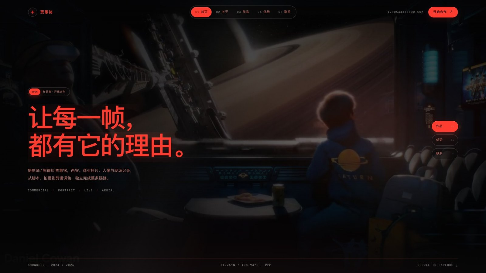
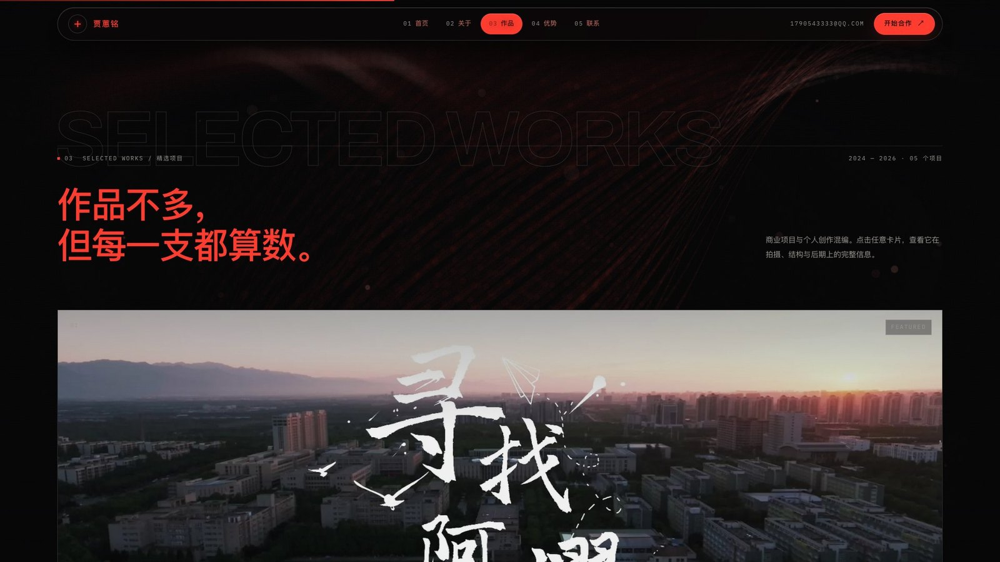
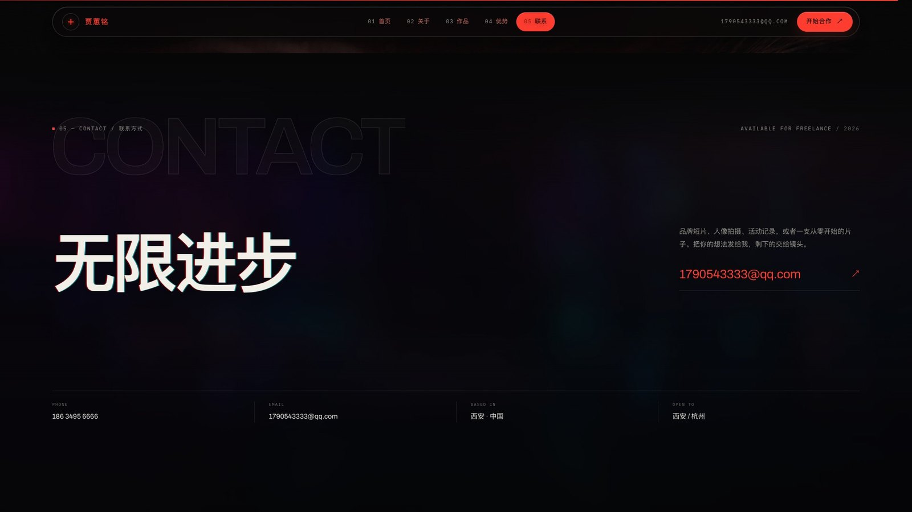
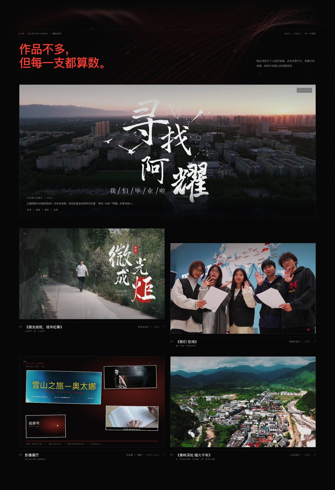
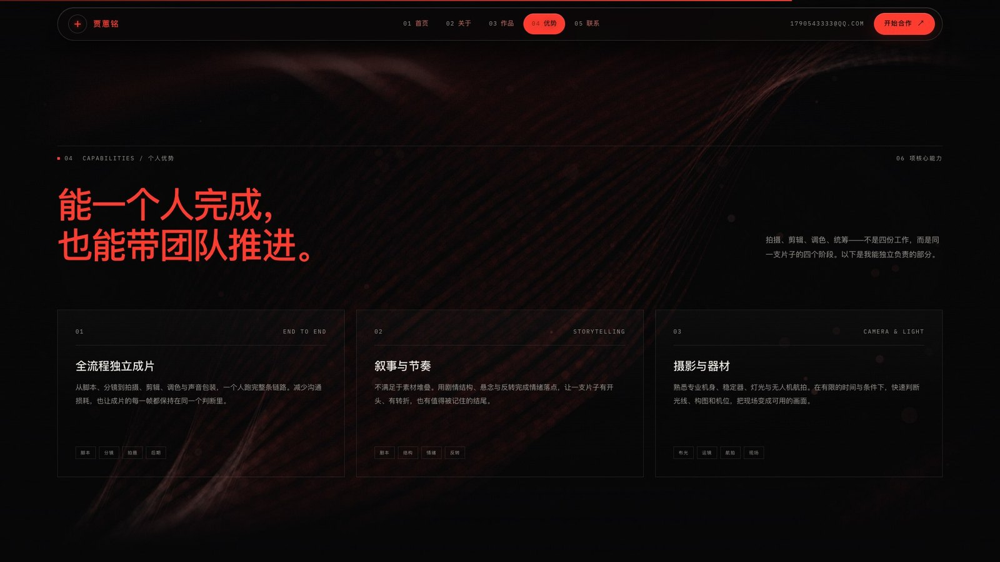
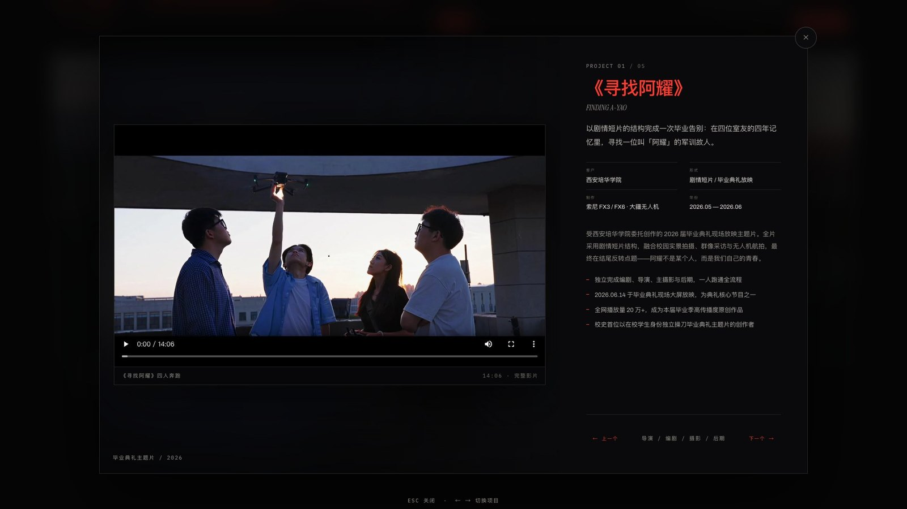
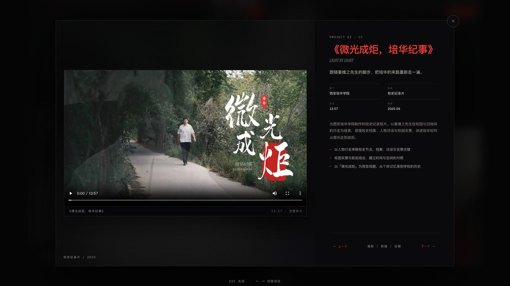
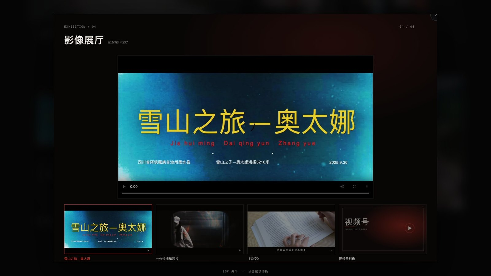

# 贾蕙铭 — 个人作品集网站

摄影师 / 剪辑师的个人作品集，React + Vite 实现。暗色、克制、带一点取景器式的科技感，适合 PC 端展示，版心 1700px。









首屏以下页面使用 GhostFibers 作为固定背景：



《寻找阿耀》《微光成炬，培华纪事》两个项目弹窗都内置完整影片播放：







## 运行

```bash
pnpm install
pnpm dev      # http://127.0.0.1:5173
pnpm build    # 类型检查 + 生产构建，输出到 dist/
pnpm preview  # 预览构建结果，http://127.0.0.1:4173
```

需要 Node 20.19+ / 22.12+（Vite 7 的要求）。`tsconfig.json` 开启了 `allowJs`，用于直接使用 GhostFibers 的 JSX 源码。

> `pnpm-workspace.yaml` 把 `rollup` 指向了 `@rollup/wasm-node`。原因是当前机器的 Node 运行时启用了库验证，无法加载 rollup 的原生二进制。换成普通 Node 环境后可以删掉 `overrides` 这一段，构建速度会更快，产物不变。

## 页面结构

| 区块 | 文件 | 内容 |
| --- | --- | --- |
| 01 Hero | `src/components/Hero.tsx` | 全屏视频背景、开场遮罩 → 标题压缩归位 → 导航/文案依次入场 |
| 02 个人经历 | `src/components/About.tsx` | 红黑照片卡（证件照默认 + 5 张生活照滚动切换）、自我介绍、联系方式、经历、4 张边框发光数据卡 |
| 03 精选项目 | `src/components/Projects.tsx` | 大卡片作品墙 + 项目弹窗：四个单片播放器 + 作品 04「影像展厅」多片展映 |
| 04 个人优势 | `src/components/Strengths.tsx` | 6 张边框发光能力卡片 + 工具列表 |
| 05 联系方式 | `src/components/Contact.tsx` | 整屏收尾页、邮箱大链接、页脚 |

所有文案、联系方式、项目与能力数据集中在 `src/data/content.ts`，改这一个文件就能更新内容。

## 首屏排版说明

首屏是「视频背景 + 左侧文案 + 右侧快捷入口 + 悬浮玻璃控件」的构图：

- 背景是 `public/video/hero-render.mp4`：从 B 站《2021 第四届世界渲染大赛 TOP100》集锦的 **0:37 到 5:00** 截取，1280×720、24fps、静音、4 分 23 秒，`loop` 无限循环。
- 视频上叠了一层深色渐变遮罩（左侧和底部更暗），保证红色标题与说明文字可读；首屏滚动离开视口后视频自动暂停，回到首屏继续播放，避免后台空转。
- 顶栏在首屏是透明悬浮的玻璃药丸（左侧圆形标记 + 姓名，中间导航，右侧邮箱 + 红色「开始合作」）。
- 页面滚动超过约 92% 屏高（进入第二屏）后，整条顶栏收成悬浮的磨砂玻璃胶囊：高度 96 → 64px、离顶 14px、`backdrop-filter: blur(34px)`，中间内容从玻璃下方透出；回到首屏再恢复透明。
- 左侧：玻璃标签（2026 / 作品集 · 开放合作）→ 两行红色大标题 → 说明段 → 服务类型；右侧三枚玻璃药丸快捷入口（作品 / 优势 / 联系）。
- 底部一条数据带：Showreel 年份、坐标、滚动提示。
- 首屏以下的整页背景接入 GhostFibers（WebGL2 光纤飘带）：固定一层画布在内容下方，颜色改为站点的红色，滚动过首屏后开始播放；首屏本身不透明，盖住这层背景。
- 全站主色为红色 `#FF3B2F`，与首屏标题统一。

## About 照片墙

- 「关于我」左侧是一张红黑照片卡：深色玻璃底、红色描边与辉光，和全站主色一致；默认显示高清证件照，下方是姓名、职位和当前照片的英文说明；卡片轻微倾斜，像一张冲印出来的照片。
- 右侧是一条自动向上滚动的缩略图胶片：6 张照片循环滚动，鼠标移入即暂停；悬停/聚焦/点击任意一张，主照片会淡入切换，角标、说明和 `01 / 06` 计数同步更新。
- 手机端照片卡居中，缩略图改成横向滑动条。
- 照片素材放在 `public/images/about/`：`id.webp` 是当前证件照（保留原始白底，不抠图，4:5 裁切到 1200×1500）；`id-cutout.webp` 是旧版的 Vision 抠像透明版，已不参与页面；`01–05.webp` 是五张生活照的 4:5 裁切，`*-thumb.webp` 是缩略图。
- 角标文案（活动现场 / 外景途中 / 山野片场 / 登顶之前 / 高原之上）和英文说明是我按画面写的，可在 `About.tsx` 的 `frames` 数组里直接改。

## 项目影片

四个单片共用「卡片海报 + 播放角标 + 弹窗播放器」；作品 04 是另一套「展厅」排版：

- `public/video/a-yao.mp4` — 你的成片《寻找阿耀》四人奔跑：源文件 2.5GB（1080p / 50fps / 25Mbps），压成 **1280×720 / 25fps / CRF 28 / 94MB**，保留原声，14:06。
- `public/images/a-yao-poster.webp` — 影片海报，取自片中四人看无人机的一帧。
- 入口：精选项目第一张大卡片改用片尾「寻找阿耀」标题帧（`work-01-ayao.webp`），悬停出现「▶ PLAY」；点开项目弹窗后，左侧是 16:9 播放器（原生控件、海报、模糊剧照背景），右侧是项目信息。手机端播放器自动变成单列置顶。
- `public/video/wei-guang.mp4` — 《微光成炬，培华纪事》：源文件 1.6GB（1080p / 50fps / 16Mbps），压成 **1280×720 / 25fps / CRF 28 / 74MB**，保留原声，13:57。
- `public/images/wei-guang-poster.webp` — 用你给的 `2025-09-05 103632.jpg` 做的 16:9 海报；`work-02-weiguang.webp` 是同一张图的 16:10 卡片裁切（保留右侧题字）。
- `public/video/we-present.mp4` — 《我们·在场》：5:17，1280×720 / 25fps / 30MB；卡片与播放器封面取自片中五人合影那一帧（`work-03-wepresent.webp`、`wepresent-poster.webp`）。
- `public/video/qinling.mp4` — 《秦岭深处 烟火千年》（作品 05）：13:27，1280×720 / 25fps / 56MB；封面取自片尾古镇航拍（`work-05-qinling.webp`、`qinling-poster.webp`）。
- 四个单片在项目弹窗里都使用同一套 16:9 播放器＋模糊海报背景；播放条会显示各自的片名和时长。
- 播放器在 React Portal 里渲染，层级高于悬浮导航；方向键在播放器聚焦时不会误触项目切换。

## 影像展厅（作品 04）

- 第四张卡片不是单片，而是一个「影像展厅」：封面是四部作品的拼贴，悬停显示「▦ ENTER」，点开进入展映弹窗。
- 弹窗里没有项目简介：上方 16:9 主银幕，下方四个展项；点击展项切换，选中项用红框标出。本地影片直接在主银幕播放，外部展项显示海报和跳转按钮。
- 展项：
  - **雪山之旅—奥太娜**（27:25）— 站内播放，`public/video/aotaina.mp4`（191MB，720p）。
  - **一分钟情绪短片**（1:04）— 站内播放，`public/video/one-minute.mp4`。
  - **《蜕变》**（5:18）— 站内播放，`public/video/tuibian.mp4`（720p，约 30MB）；从桌面 `《蜕变》.mp4` 重新压制的版本。
  - **《叁佰》**（6:59）— 站内播放，`public/video/sanbai.mp4`（720p，约 32MB）；封面取自片中三人同行镜头。
  - **校园文化的守望者** — 视频号记者节内容。微信视频号预览页只返回封面和文案，视频流需要微信授权，浏览器无法直接取到；目前用真实封面 +「在微信视频号观看」。拿到视频文件后可直接改成站内播放。
- 展厅封面、主银幕海报、展项缩略图都在 `public/images/gallery/`。

## 作品卡片（ProfileCard 效果）

- 作品区每张卡片的画框改成 18px 圆角，并接入《作品边框.docx》里 ProfileCard 的那套交互：鼠标移动时整张画框轻微 3D 倾斜，白色 glare 跟随指针，叠加一层红/青/紫的全息反光。
- 参考文档参数：`tiltStrength=12`、`parallax=8`、`holo=0.8`、`glare=0.5`、`radius=16`、`theme="dark"`；实际用了 10° 倾斜、18px 圆角和更克制的 0.55 反光，避免盖住照片。
- 实现：`src/components/Projects.tsx` 里的 pointer 逻辑（GSAP quickTo）+ `projects.css` 的 `::after` 全息层；只在精细指针设备启用，移动端和 `prefers-reduced-motion` 下保持静态圆角画框。
- 点击、播放角标、项目弹窗都不受影响。

## 收尾页标题（GlitchText）

- 最后一页原来的「有想法？我们聊聊。」已换成 **无限进步**，使用《文本.docx》里的 React Bits GlitchText 参数：`mode="slices"`、`trigger="always"`、`speed={1}`、`intensity={0.5}`、`burstDuration={0.6}`、`offset={10}`、`fontWeight={900}`、红色/青色双阴影。
- 实现：`src/components/GlitchText.jsx` + `GlitchText.css`。主字是白色 900 字重，红/青错位阴影常驻；每隔约 4.2s 在两个时间窗出现横向切片错位和色差，结束后回到干净的字面。
- 想更频繁/更强：改组件传入的 `speed` / `intensity`，或直接调 `GlitchText.css` 的 `--glitch-speed`、`--glitch-offset` 与关键帧窗口。
- 「作品不多，但每一支都算数。」也使用同一个 GlitchText：白色 900 字重 + 红/青阴影 + 切片错位；模块的英文描边大字保持不变。
- `prefers-reduced-motion` 下动画停止，只保留静态白字。

## 动效系统（GSAP + ScrollTrigger）

- **首屏开场**：全屏 `intro`（贾蕙铭 / 红线 / PORTFOLIO）→ 遮罩自下而上揭开 → 视频从 1.18 倍回落到 1 → 标题两行从遮罩下方抬升、横向压缩 1.09 → 1 归位，随后标签、描述、快捷入口依次入场。
- **每个模块**：巨型英文描边字（PROFILE / SELECTED WORKS / CAPABILITIES / CONTACT）先从左侧遮罩进入，中文标题再以底部遮罩抬升，右侧说明最后；卡片按 0.08–0.12s 间隔 stagger。
- **图片**：项目卡片用 clip-path 揭开 + 1.1 → 1 缩放，滚动时叠加 ±4% 轻 parallax；About 照片卡、联系页背景也各有 reveal/parallax。
- **实现**：`gsap` 3.15 + ScrollTrigger，代码在 `src/motion/siteMotion.ts`，样式在 `src/styles/motion.css`；只改 transform/opacity/clip-path，入场 `once`，parallax `scrub`，不触发布局。
- **节奏**：统一 `expo.out`，入场 1.3–2.6s，无回弹；移动端缩短位移并减小 parallax；`prefers-reduced-motion` 下移除 intro、保留静态布局。
- 想调快慢/幅度：改 `siteMotion.ts` 里的 duration / stagger / start；英文大字改 `motion.css` 的 `sec-head__ghost` 字号和描边。

## 边框发光卡片（BorderGlow）

- 优势区 6 张能力卡、关于区底部 4 张数据卡（70 万+ 等）都换成了你给的《边框发光.docx》里的 BorderGlow 组件：鼠标靠近卡片边缘时，才出现红色网格渐变描边和外侧辉光，离开后淡出。
- 组件源码在 `src/components/BorderGlow.jsx` / `BorderGlow.css`，逻辑按文档保留；只把配色和尺寸改成站点风格：`glowColor="5 100% 60%"`、`colors` 红/橙/暗红，背景 `#0b0908`，圆角 18（优势）/ 14（数据）。
- 触屏或没有 hover 指针的设备退化成普通描边，不影响排版。
- 数据区从原来的「一条数据带」改成四张独立卡片：70 万+ / 01 / 04 / 2023。

## 页面背景（GhostFibers）

- 组件源码来自你提供的《效果.docx》，已原样落到 `src/components/GhostFibers.jsx` 和 `src/components/GhostFibers.css`，没有改动内部逻辑。
- `App.tsx` 里以固定画布的方式铺在 `<main>` 下方：颜色改成站点红（`glowColor="#ff3b2f"`、深红副色、浅粉高光），3 层光纤、96/80 根、红色双色渐变。
- 首屏内 `paused`，滚过约 92% 屏高后开始播放；`.page-bg::after` 的遮罩控制它透出的强度。
- 需要浏览器支持 WebGL2；不支持时只是纯黑背景，不影响排版。

## 素材

- `public/video/hero-render.mp4` — 首屏视频：B 站集锦 0:37–5:00，1280×720 / 24fps / 静音 / 4:23 / 24MB
- `public/images/hero-render-poster.webp` — 首屏视频封面
- `public/images/hero-glass.webp`、`public/images/hero-portrait.webp`、`public/video/hero.mp4`、`public/images/hero-poster.webp` — 之前的首屏玻璃/人像/旧视频素材，当前未使用，保留备用
- `public/images/portrait.webp` — 旧版个人经历区人像，已被 About 照片墙替代，保留备用
- `public/images/about/*` — About 照片墙：证件照高清版、5 张生活照裁切与缩略图
- `public/images/work-01-ayao.webp`、`work-02-weiguang.webp`、`work-03-wepresent.webp`、`work-05-qinling.webp` — 四个单片的封面；`public/images/gallery/exhibition-card.webp` — 展厅封面
- `public/video/aotaina.mp4`、`one-minute.mp4`、`tuibian.mp4`、`sanbai.mp4` — 展厅里的四部站内影片
- `public/images/gallery/*` — 展厅海报、展项缩略图与 16:9 主银幕封面
- `public/images/contact-bg.webp` — 收尾页背景（由首屏封面虚化生成）
- `public/fonts/*.woff2` — 自托管字体（Archivo / IBM Plex Mono / Instrument Serif）

**注意：** 五个项目的封面、海报和影片都来自你的成片/素材。视频号仍是外部链接（不可嵌入），其余影片（含《蜕变》）都是站内播放。旧的 `work-03.webp`、`work-04.webp`、`work-05.webp` 与 `work-04-qinling.webp` 已不再使用，保留备用。

生成素材的脚本在 `scripts/build-assets.py`（需要 Pillow / numpy），只用于这次占位素材的处理，可删除；注意它会覆盖 `work-01.webp`，而首屏项目现在用的是 `work-01-ayao.webp`，运行前先确认不会误删。占位图片均来自 Unsplash（免费使用），具体 photo id 见脚本中的 `specs`。

**版权提醒：** 首屏视频截取自 B 站上的《2021 年第四届世界渲染大赛 TOP100 作品欣赏》集锦（UP 主：Youtube高质量精选），画面版权归各原作者所有。目前仅用于本地效果预览；如果要公开部署上线，请替换成你自己拍摄/拥有授权的视频，或先取得原作者许可。

## 关于内容准确性

页面中的姓名、电话、邮箱、教育经历、工作经历与《寻找阿耀》项目信息均来自简历原文。项目数据（70 万+ 播放、校史首位学生导演、4 个主创环节等）按你最新提供的口径更新。

以下内容是为版式补写的**示例文案**，请在替换作品时一并改写：

- 项目 03《我们·在场》的分工为「导演 / 拍摄 / 剪辑 / 调色」，项目 05《秦岭深处 烟火千年》为「导演 / 拍摄 / 剪辑」（按你确认）；两部片子的简介、要点、客户/拍摄地/年份是按片名与画面补写的，请核对后调整
- 作品 04 展厅的策展文案（作品名、时长）按素材整理；视频号内容仍按你提供的地址外链（预览页不提供视频流）
- 个人优势 6 张卡片的描述
- 首屏与收尾页的广告语

## 设计说明

- 主色：全站主色统一为 `#FF3B2F`（首屏标题的红色），区块大标题、序号、按钮、链接都用这一支红；正文保持暖白以保证可读性。
- 交互：所有按钮都有明确的悬浮换色 —— 实心红按钮悬停反白为红字，玻璃药丸悬停填充红色，导航项悬停变成红色药丸，弹窗翻页按钮悬停填充红色。
- 材质：玻璃药丸统一用 `--glass` / `--glass-line` 变量（深色半透明 + 1px 高光边 + backdrop blur），在移动端保留同样的层次。
- 字体：Archivo 做标题与大数字，IBM Plex Mono 做标签与数据，Instrument Serif 只做少量英文斜体；中文回落到 PingFang SC / Noto Sans SC。
- 页面背景：`GhostFibers` 组件（来自你提供的组件文档，源码在 `src/components/GhostFibers.jsx`，样式在 `GhostFibers.css`）以固定画布铺在首屏以下，红色双色光纤 + 景深 + 泛光；在首屏时暂停，滚过约 92% 屏高后开始播放，`prefers-reduced-motion` 下组件自动静止。
- 细节：全屏底噪、滚动进度条、取景器四角标记与网格线、时间码、滚动入场动画、项目详情弹窗（Esc 关闭，← → 切换）。
- 响应式：以 PC 为主，同时适配平板与手机；`prefers-reduced-motion` 下关闭动效。
- About 照片墙：红黑照片卡 + 自动滚动胶片条，悬停/聚焦切换主图；`prefers-reduced-motion` 下胶片条停止滚动。
- 边框发光：优势卡片和数据卡用 BorderGlow 的边缘感应辉光，红色网格渐变只跟随鼠标靠近的边缘出现。
